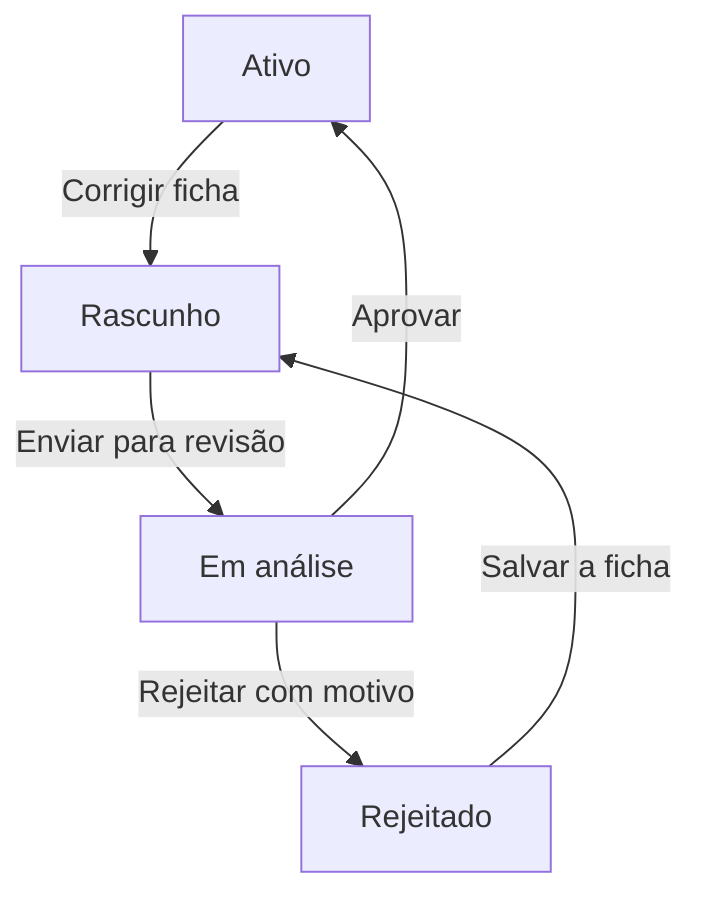

# Ajuste de hotel ativo — Design

**Spec**: `.specs/features/ajuste-hotel-ativo/spec.md`  
**Status**: Draft

Não há status novo. A correção reentra no ciclo que já existe: rascunho, análise, ativo ou rejeitado.

Enquanto está em rascunho ou rejeitado, o parceiro edita dados, quartos e fotos. As regras de envio não mudam: conta aprovada, ao menos um quarto, foto e capa do hotel, e ao menos uma foto em cada quarto.

## O que muda

| Peça | Mudança |
| ---- | ------- |
| `POST /extranet/hotels/:id/correction` | Só a partir de ACTIVE. Grava DRAFT, limpa `rejectionReason` e registra ACTIVE → DRAFT com ator PARTNER |
| Ficha do hotel ativo | Botão "Corrigir ficha". Os outros status não mostram o botão |
| Fila e dossiê do admin | Nenhuma tela nova. O hotel reaparece na fila quando volta a IN_REVIEW. O histórico mostra o pedido |
| Aprovar e rejeitar | Os métodos atuais. Aprovar volta a ACTIVE. Rejeitar grava o motivo |

O clique pede confirmação: "A ficha sai do ar até a equipe Revoar aprovar de novo." Hoje não há busca pública, mas o selo deixa de ser Ativo na hora.

## O que não muda

- Em análise, nome e endereço continuam bloqueados. Quartos e fotos também.
- O admin não edita campo.
- Hotel inativo não ganha o botão.

## Quando a busca do hóspede existir

A versão aprovada precisa continuar visível enquanto a correção é um rascunho à parte. Isso não entra nesta entrega.
