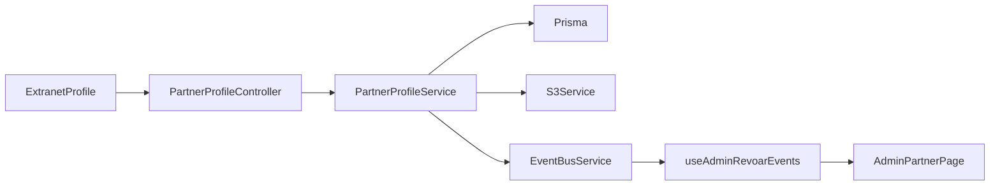

# Perfil do parceiro — Design

**Spec**: `.specs/features/extranet-perfil-parceiro/spec.md`  
**Status**: Draft

Decisões ativas respeitadas: AD-002 (Nest + Prisma + Next), AD-003 (parceiro PJ), AD-007 (extranet self-service, admin aprova), AD-009 (Query + SSE no `EventBusService`), AD-010 (PageShell, Surface, Plus Jakarta, `#0E7490`). Nova: AD-011 — admin lê a ficha e não a edita.

---

## Architecture Overview

A extranet grava a ficha. O admin só lê, com o mesmo formato. Fotos usam o presign S3 já usado pelos hotéis, com outro prefixo de chave. Confirmar ou alterar dados emite `partner.profile.updated` no canal de admins que a Fase 7 já consome.

Abordagem escolhida: um módulo `extranet/profile` novo, e a leitura admin estende `AdminPartnersService`. Não se cria um segundo banco nem um app novo.

## Code Reuse

- `S3Service.createPresignedUpload` ganha um irmão para `partners/{partnerId}/avatar|logo`. CORS de loopback já está em `apps/api/src/storage/s3.service.ts`.
- Limites de imagem: `ALLOWED_IMAGE_TYPES` e `MAX_IMAGE_SIZE_BYTES` em `@revoar/shared`.
- `GET /extranet/auth/me` em `partner-auth.service.ts` `getProfile` passa a incluir avatar, logo e `detailsConfirmedAt`.
- SSE admin: `useAdminRevoarEvents` já invalida filas; passa a invalidar `adminKeys.partner(id)`.
- UI: `PageShell`, `PageHeader`, `Surface`, `Input`, `Button`, `Alert`, pílula de status do dashboard. Sem biblioteca de menu nova: painel absoluto no header.

## Components and Interfaces

| Peça | Onde | Interface |
| ---- | ---- | --------- |
| Schema Zod | `packages/shared/src/schemas/profile.schema.ts` | `updatePartnerProfileSchema`, `confirmPartnerProfileSchema`, `presignProfileImageSchema` |
| Evento | `packages/shared/src/events.ts` | `{ type: "partner.profile.updated"; partnerId: string }` |
| Presign | `S3Service` | `createPartnerAssetUpload({ partnerId, kind, contentType })` |
| Escrita | `PartnerProfileService` | `update`, `presign`, `confirm` — sempre `partnerId` do JWT |
| Leitura admin | `AdminPartnersService.getById` | Dossiê completo; 404 se não existe |
| Lista | `listPending` | Campo `detailsConfirmed: boolean` |
| UI extranet | `apps/extranet/src/app/profile/page.tsx` | Seções via `?section=` |
| UI admin | `apps/admin/src/app/partners/[id]/page.tsx` | Somente leitura + aprovar se PENDING |

`GET admin/partners/:id` registra-se depois de `GET pending`, para `pending` não cair no parâmetro.

PATCH estrito. Campos proibidos (`legalName`, `cnpj`, `email`, `status`) fazem o Zod falhar o body inteiro: HTTP 400, nada é gravado.

`confirm` exige `name`, `phone`, `contactName`, `avatarUrl`, `logoUrl`. Senão HTTP 422 `{ missing: string[] }`. Sucesso grava `detailsConfirmedAt = now()`. Qualquer `update` ou troca de URL zera esse campo antes de emitir o evento.

Chave S3 aceita no PATCH só se começar com `partners/{partnerId}/avatar/` ou `partners/{partnerId}/logo/`.

## Data Model

Em `packages/database/prisma/schema.prisma`:

- `PartnerUser.avatarUrl` `String?` `@map("avatar_url")`
- `Partner.logoUrl` `String?` `@map("logo_url")`
- `Partner.detailsConfirmedAt` `DateTime?` `@map("details_confirmed_at")`

Migration Prisma nova. Sem backfill: registros atuais nascem não confirmados e sem foto.

## UI

Desktop extranet: faixa com avatar 96px, nome, nome fantasia e pílula de status; quatro checks (foto, logo, contato, confirmação); menu ~220px; conteúdo em `Surface`.

Mobile: a mesma faixa, seções em chips, botão Confirmar fixo só em Revisar.

Admin: os mesmos blocos, sem inputs e sem Confirmar. A fila ganha o texto "Confirmou" ou "Não confirmou". O detalhe do hotel linka o nome do parceiro.

Header da extranet: avatar ou inicial abre Meu perfil e Sair. O cartão "Dados da empresa" do painel aponta para `/profile`.

## Risks & Concerns

| Concern | Mitigation |
| ------- | ---------- |
| `GET :id` capturar `pending` | Rota estática `pending` permanece declarada antes |
| URL de foto de outro parceiro | Prefixo `partners/{partnerId}/` conferido no servidor |
| Admin e extranet compartilham JWT sem audience | Guards atuais (`AdminJwtAuthGuard` vs partner) continuam; e2e cobre token trocado |
| Sem testes unitários no repo | Gate é `npm run test:e2e` mais `npm run build` |
| Ficha aberta com query antiga | Evento `partner.profile.updated` invalida a query do parceiro |

## Out of scope reminder

Viajante, troca de e-mail, edição fiscal e edição pelo admin não entram neste design.
