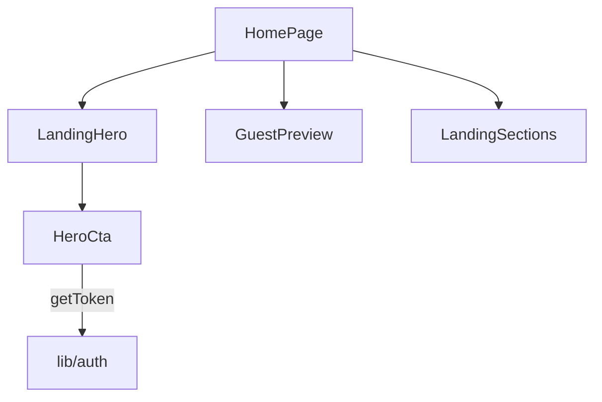

# Landing pública — Design

**Spec**: `.specs/features/landing-publica/spec.md`  
**Status**: Approved

Decisões ativas respeitadas: AD-010 (PageShell, Surface, Plus Jakarta, `#0E7490`). A landing substitui `apps/extranet/src/app/page.tsx` e não cria rota, app nem endpoint.

---

## Architecture Overview

A page é um Server Component que só compõe três seções. A única peça com estado de sessão é o CTA do hero; a prévia tem estado local de aba. Nada chama a API.

## Code Reuse

- `PageShell` e `Surface` de `apps/extranet/src/components`.
- `getToken` e `AUTH_CHANGE_EVENT` de `apps/extranet/src/lib/auth.ts`, no mesmo padrão de `useRequireAuth`: estado `null` no primeiro render e leitura no effect, para o HTML do servidor bater com o do cliente.
- Ícones `lucide-react`, já dependência.
- Header atual sem alteração.

## Components and Interfaces

| Peça | Onde | Interface |
| ---- | ---- | --------- |
| Hero | `apps/extranet/src/components/landing/landing-hero.tsx` | Título, linha de apoio, `HeroCta`, porta do hóspede |
| CTA | `apps/extranet/src/components/landing/hero-cta.tsx` | Client; sem token: "Cadastrar hotel" (`/signup`) e "Já tenho conta" (`/login`); com token: "Ir para o painel" (`/dashboard`) |
| Prévia | `apps/extranet/src/components/landing/guest-preview.tsx` | Client; `role="tablist"` com quatro `role="tab"` e um `role="tabpanel"`; selo "Em breve" fixo |
| Passos e grade | `apps/extranet/src/components/landing/landing-sections.tsx` | Três passos e grade assimétrica; itens futuros com "Em breve" |
| Page | `apps/extranet/src/app/page.tsx` | Compõe as três seções |

A porta "Área do hóspede" é `<button type="button" disabled>`. Não usa `Link`.

## Visual

- Cores só dos tokens: `primary`, `foreground`, `muted-foreground`, `surface`, `muted`, `border`. Sem `accent` laranja, para ficar em três a quatro cores.
- Título `font-extrabold` com `tracking-tight`; apoio em `font-normal` e `text-muted-foreground`.
- Blocos `rounded-2xl`, borda `border-border/80`, hover em controles ativos.
- Só escala padrão do Tailwind; nenhum valor entre colchetes nos arquivos novos.
- Mobile-first: CTAs em coluna com `w-full` abaixo de `sm`, altura mínima `h-12`.

## Error Handling

Sem chamadas de rede. Sessão inválida já é tratada pelo `expireSession` global; quando o token some, `AUTH_CHANGE_EVENT` faz o CTA voltar ao estado de visitante.

## Testing

Playwright em `e2e/landing.spec.ts`. Sessão real via login da API com `parceiro@revoar.com.br`, gravada no `localStorage` antes de abrir `/`.
