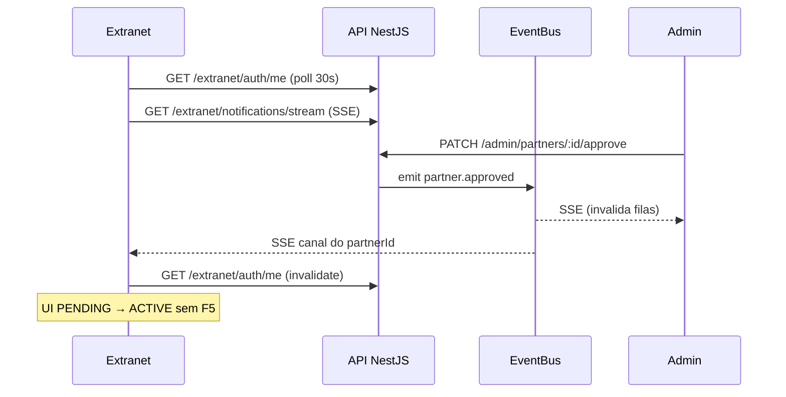

# Design — Sync de dados sem F5 (Fase 7)

**Spec:** `.specs/features/sync-tempo-real/spec.md`  
**Status:** Implemented (Jul/2026)  
**Decisão:** AD-009 — TanStack Query + SSE; WebSocket adiado

---

## Architecture Overview

Duas camadas independentes; nenhuma substitui a outra:

```
┌──────────────┐  invalidate   ┌─────────────────┐
│  Admin UI    │◄──────────────│  SSE /admin/    │
│  Extranet UI │               │  notifications  │
│              │  poll 30s     │  /stream        │
│ TanStack     │──────────────►│  API NestJS     │
│ Query        │  REST         │                 │
└──────────────┘               │ EventBusService │
                               │ (EventEmitter)  │
                               └────────┬────────┘
                                        │ emit
                    approve / reject / submit
```

1. **Fonte da verdade:** REST (Prisma). SSE só avisa “invalide o cache”.
2. **Cache UI:** TanStack Query v5 em cada app Next.js.
3. **Push:** `EventBusService` in-process → Observable Nest `@Sse()`.
4. **Fallback:** polling condicional 30s + `refetchOnWindowFocus`.

---

## Stack

| Camada | Tecnologia | Onde |
|--------|------------|------|
| Cache / refetch | `@tanstack/react-query` v5 | `apps/admin`, `apps/extranet` |
| Provider | `QueryProvider` + `RevoarEventsListener` | `apps/*/src/components/providers/query-provider.tsx` |
| Query keys | `adminKeys` / `extranetKeys` | `apps/*/src/lib/query-keys.ts` |
| Eventos | `RevoarEvent` union | `packages/shared/src/events.ts` |
| Bus | `EventBusService` (`EventEmitter`) | `apps/api/src/events/` |
| SSE | Nest `@Sse()` + RxJS `Observable` | `admin/notifications`, `extranet/notifications` |
| Auth stream | JWT no header (`fetch`, não `EventSource`) | `use-revoar-events.ts` |

**Defaults QueryClient:** `refetchOnWindowFocus: true`, `refetchOnReconnect: true`, `staleTime: 10s`, `retry: 1`.

---

## Event contract

```typescript
type RevoarEvent =
  | { type: "partner.approved"; partnerId: string }
  | { type: "hotel.submitted"; hotelId: string; partnerId: string }
  | { type: "hotel.approved"; hotelId: string; partnerId: string }
  | { type: "hotel.rejected"; hotelId: string; partnerId: string; reason: string };
```

### Quem emite

| Ação | Serviço | Canais |
|------|---------|--------|
| Admin aprova parceiro | `admin-partners.service` | admin + `revoar:partner:{id}` |
| Admin aprova/rejeita hotel | `admin-hotels.service` | admin + parceiro dono |
| Parceiro submete hotel | `extranet/hotels.service` | admin + parceiro dono |

### Canais

```
revoar:admin                 → todos os operadores autenticados
revoar:partner:{partnerId}   → só o parceiro dono
```

Parceiro **nunca** recebe eventos de outro `partnerId`. Admin recebe todos os eventos de moderação.

---

## API

| Method | Route | Auth | Descrição |
|--------|-------|------|-----------|
| GET | `/admin/stats` | Admin JWT | `{ pendingPartners, pendingHotels }` |
| GET | `/admin/notifications/stream` | Admin JWT | SSE `text/event-stream` |
| GET | `/extranet/notifications/stream` | Partner JWT | SSE filtrado por `partnerId` |

Formato SSE (Nest `MessageEvent`):

```
data: {"type":"hotel.approved","hotelId":"...","partnerId":"..."}

```

Não usamos `EventSource` nativo: ele não envia `Authorization`. O hook faz `fetch` + `ReadableStream` e parseia blocos `data:`.

Reconexão: loop `while (!aborted)` com wait 3s após close/erro.

---

## Frontend — query keys e polling

### Admin (`adminKeys`)

| Key | Onde | Polling |
|-----|------|---------|
| `["admin","stats"]` | `GET /admin/stats` | disponível; dashboard ainda usa listas |
| `["admin","partners","pending"]` | `/partners/pending` + dashboard | 15s |
| `["admin","hotels","pending"]` | `/hotels/pending` + dashboard | 15s |
| `["admin","hotels", id]` | `/hotels/[id]` | 15s se `IN_REVIEW` |

Mutations de approve/reject invalidam stats + filas + hotel.

### Extranet (`extranetKeys`)

| Key | Onde | Polling |
|-----|------|---------|
| `["extranet","auth","me"]` | dashboard | 30s se `PENDING` |
| `["extranet","hotels", …]` | lista | 30s se algum `IN_REVIEW` |
| `["extranet","hotels", id]` | `useHotel` | 30s se `IN_REVIEW` |

Submit/delete invalidam hotel + lista.

---

## SSE → invalidate (admin)

Qualquer `RevoarEvent` invalida `stats`, `pendingPartners`, `pendingHotels`. Se o evento tiver `hotelId`, invalida também o detalhe.

Extranet: `partner.approved` → `extranetKeys.me`; eventos de hotel → hotel + prefixo `["extranet","hotels"]`.

---

## UX

Componente `LastUpdated` (`apps/*/src/components/last-updated.tsx`) recebe `dataUpdatedAt` do `useQuery` e mostra “Atualizado há Xs”.

Páginas:

- Admin: `/dashboard`, `/partners/pending`, `/hotels/pending`, `/hotels/[id]`
- Extranet: `/dashboard` (PENDING), `/hotels`, `/hotels/[id]` (header)

---

## Fluxo — aprovação de parceiro



---

## Limites conhecidos e evolução

| Limite | Impacto | Evolução |
|--------|---------|----------|
| `EventEmitter` in-process | Multi-instância da API não compartilha eventos | Redis Pub/Sub, mesma interface `EventBusService` |
| Sem heartbeat SSE explícito | Proxies podem fechar conexão ociosa | `comment` ping a cada 15s (se necessário em staging) |
| Sem E2E do stream | Regressão de sync não pega no CI | Spec Playwright com duas origens (admin + extranet) |
| Eventos só de moderação | Reserva/pagamento ainda não emitem | Estender `RevoarEvent` na Release 0.5 (RF-028) |

---

## Relação com o design da 0.0

O `design.md` de `admin-cadastro-parceiros` descreve REST + páginas. Esta feature **não muda o modelo de dados** nem as regras de submit/aprovação — só o **transporte de atualização de UI**.
