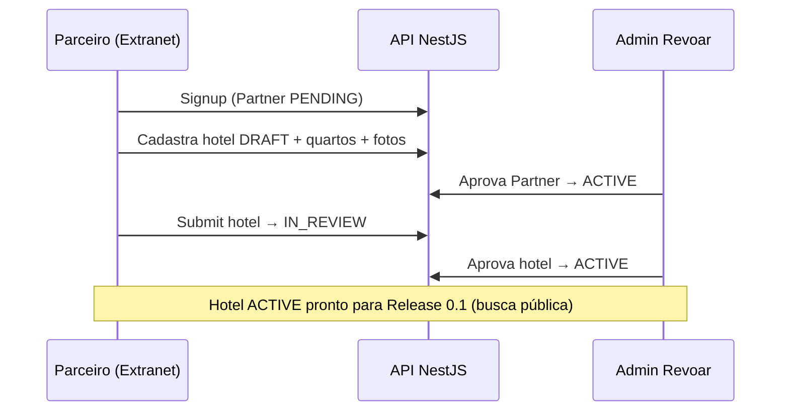

# Release 0.0 — Extranet MVP (Entrega)

**Data:** Junho/2026  
**Feature ID:** `extranet-cadastro-parceiros`  
**Status:** Código completo (fases 0–6) · DoD de negócio parcial

Este documento consolida **o que foi feito**, **o que ficou de fora** e **como retomar o trabalho** — especialmente para agentes Cursor ou desenvolvedores em uma máquina nova.

---

## 1. O que é este repositório

Dois produtos convivem no mesmo repo:

| Camada | Conteúdo | Público |
|--------|----------|---------|
| **Master Plan** | `docs/` (11 fases, ~3.500 linhas) | Sócios, produto, engenharia |
| **Implementação** | Monorepo `apps/` + `packages/` | Desenvolvimento Release 0.0+ |

**Revoar** é uma plataforma de turismo focada em reserva de hotéis. A Release 0.0 entrega o **cadastro de inventário próprio** (hotéis direct): parceiros PJ se cadastram na extranet, preenchem hotel + quartos + fotos, e a equipe Revoar aprova via admin interno.

**Ainda não existe:** site público para viajantes, busca, tarifas, disponibilidade, reserva ou pagamento.

---

## 2. Linha do tempo do projeto

```
Fase A — Master Plan (docs/00 … docs/10)
    ↓
Fase B — Spec-driven (.specs/features/admin-cadastro-parceiros/)
    ↓ decisões AD-001 … AD-008 em .specs/STATE.md
Fase C — Implementação Release 0.0 (fases 0–6, Jun/2026)
    ↓
Próximo — Release 0.1: busca pública read-only
```

---

## 3. O que foi entregue (por fase técnica)

### Fase 0 — Setup monorepo

- Turborepo + npm workspaces (`apps/extranet`, `apps/admin`, `apps/api`, `packages/database`, `packages/shared`)
- Docker Compose: PostgreSQL 16 + LocalStack S3
- Prisma schema: Partner, PartnerUser, AdminUser, Hotel, RoomType, HotelImage, HotelStatusHistory
- Seed: 1 admin + 1 parceiro ACTIVE + 1 hotel exemplo
- NestJS com `/health`

### Fase 1 — Auth parceiro

- `POST /extranet/auth/signup`, `login`, `GET /me`
- JWT partner com isolamento por `partnerId`
- UI: `/signup`, `/login`, `/dashboard`
- Parceiro `PENDING` pode cadastrar hotéis DRAFT mas não enviar para revisão

### Fase 2 — Hotéis

- CRUD hotel na API + wizard UI
- Slug único com sufixo `-2`, `-3` em colisão
- ViaCEP no cliente para preenchimento de endereço
- Listagem `/hotels` com filtro por status

### Fase 3 — Quartos

- CRUD RoomType com campos completos (capacidade, camas, amenities, size_sqm)
- Validação de ocupação (`max_occupancy >= max_adults + max_children`)
- Submit bloqueado sem ≥1 quarto

### Fase 4 — Fotos + Submit

- S3 presigned URL (LocalStack local / AWS em produção)
- Galeria + foto principal (`is_primary` único)
- `POST /extranet/hotels/:id/submit` com validação completa
- Hotéis `IN_REVIEW`: edição parcial (descrição, telefone, horários); nome/endereço bloqueados

### Fase 5 — Admin moderação

- Auth admin separada (JWT distinto)
- Aprovar/rejeitar parceiros `PENDING` → `ACTIVE`
- Aprovar/rejeitar hotéis `IN_REVIEW` → `ACTIVE` / `DRAFT` + motivo
- Preview completo do hotel (quartos, fotos)
- `HotelStatusHistory` em transições de status
- Dashboard com contadores e links para filas

### Fase 6 — Qualidade + infra

- Playwright E2E: fluxo completo + parceiro PENDING bloqueado no submit
- CI GitHub Actions (`.github/workflows/e2e.yml`)
- `NotificationsService` com Resend (stub no console sem `RESEND_API_KEY`)
- `docker-compose.staging.yml` para stack containerizada local
- `DEVELOPMENT.md` + este documento

---

## 4. O que NÃO foi entregue (gaps conhecidos)

| Item | Spec / DoD | Status | Notas |
|------|------------|--------|-------|
| ≥ 10 hotéis piloto cadastrados | DoD negócio | ❌ | Depende de operação manual / sócios |
| Deploy staging em URL pública | T6.4 | ❌ | Infra Docker pronta; sem hosting cloud |
| E-mail real em produção | T6.3 | ⚠️ | Stub funcional; Resend opcional via env |
| Reset de senha | Edge case P2 | ❌ | Não implementado |
| Fotos de quarto | Assumption spec | ❌ | Apenas fotos do hotel no P1 |
| Múltiplos usuários por parceiro | Out of scope P2 | ❌ | |
| Site público / busca | Release 0.1 | ❌ | Próximo milestone |
| Testes unitários (Vitest) | Mencionado no design | ❌ | Apenas E2E Playwright |
| PDFs gerados no repo | Script existe | ⚠️ | Rodar `npm run pdf` localmente |

---

## 5. Stack e estrutura de pastas

```
plan-revoar/
├── apps/
│   ├── extranet/          Next.js 15 — parceiro (porta 3000)
│   ├── admin/             Next.js 15 — moderação (porta 3001)
│   └── api/               NestJS REST (porta 3002)
├── packages/
│   ├── database/          Prisma + migrations + seed
│   └── shared/            Schemas Zod compartilhados
├── e2e/                   Playwright
├── infra/                 Dockerfiles
├── docs/                  Master Plan (11 fases)
├── .specs/                Spec-driven: STATE, features, validation
├── scripts/               export-pdfs, e2e.sh
├── docker-compose.yml
├── docker-compose.staging.yml
├── DEVELOPMENT.md         Referência técnica detalhada
└── RELEASE-0.0.md         Este arquivo
```

**Stack:** Node ≥20, npm workspaces, Turborepo, Next.js 15, NestJS, Prisma, PostgreSQL, Tailwind 4, Zod, AWS SDK (S3), Playwright.

> **Nota:** `design.md` menciona pnpm e Vitest; o monorepo usa **npm** e testes **E2E apenas**.

---

## 6. Fluxo de negócio principal



**Estados Partner:** `PENDING` → `ACTIVE` | `SUSPENDED`  
**Estados Hotel:** `DRAFT` → `IN_REVIEW` → `ACTIVE` (ou volta `DRAFT` se rejeitado)

---

## 7. Decisões de produto (resumo)

Detalhes completos em `.specs/STATE.md` (AD-001 … AD-008).

| ID | Decisão |
|----|---------|
| AD-001 | Inventário first — cadastro antes do site público |
| AD-002 | Monorepo Next.js + NestJS + Prisma + PostgreSQL |
| AD-003 | Parceiro = PJ com CNPJ obrigatório |
| AD-007 | Extranet self-service + aprovação Revoar via admin |
| AD-008 | Quartos completos no P1 (dados para viajante futuro) |

**Roadmap revisado:**

```
Release 0.0  Extranet MVP     ✅ (este release)
Release 0.1  Busca pública   → próximo
Release 0.5  Reserva + pagamento
Release 1.0  GA — 5 destinos
```

---

## 8. Setup rápido (nova máquina)

```bash
cp .env.example .env
cp apps/extranet/.env.local.example apps/extranet/.env.local
cp apps/admin/.env.local.example apps/admin/.env.local
docker compose up -d
npm install
npm run db:generate && npm run db:migrate && npm run db:seed
npm run dev
```

| App | URL | Login seed |
|-----|-----|------------|
| Extranet | http://localhost:3000 | parceiro@revoar.com.br / revoar123 |
| Admin | http://localhost:3001 | admin@revoar.com.br / revoar123 |
| API | http://localhost:3002/health | — |

**Build:** `npm run build` (todos workspaces)  
**E2E:** ver seção em `DEVELOPMENT.md`

---

## 9. Ordem de leitura para agentes Cursor

Para entender **100% do contexto** antes de implementar qualquer coisa:

1. **`.specs/STATE.md`** — decisões ativas, handoff, próximo passo
2. **`RELEASE-0.0.md`** — este arquivo (escopo entregue vs. gaps)
3. **`.specs/features/admin-cadastro-parceiros/spec.md`** — requisitos com IDs rastreáveis
4. **`.specs/features/admin-cadastro-parceiros/validation.md`** — evidências de verificação
5. **`DEVELOPMENT.md`** — endpoints, páginas, setup, E2E
6. **`.specs/features/admin-cadastro-parceiros/design.md`** — arquitetura e modelo de dados
7. **`docs/09-roadmap/fase-09-roadmap.md`** — visão de produto de longo prazo
8. **`docs/`** (demais fases) — apenas se a tarefa exigir contexto de negócio

**Regra:** Release 0.0 está **fechada no código**. Novo trabalho deve partir de Release 0.1 salvo correções ou débitos explícitos deste release.

---

## 10. Próximo passo recomendado

**Release 0.1 — Busca pública read-only**

- Site público listando hotéis `ACTIVE`
- Páginas de detalhe hotel + quartos (dados já cadastrados na extranet)
- Integração Hotelbeds sandbox (conforme roadmap)
- Nova feature spec em `.specs/features/` antes de implementar

---

## 11. Referências cruzadas

| Documento | Propósito |
|-----------|-----------|
| `README.md` | Índice geral + quick start |
| `DEVELOPMENT.md` | API, páginas, testes, staging |
| `.specs/STATE.md` | Memória do projeto (decisões + handoff) |
| `.specs/features/admin-cadastro-parceiros/tasks.md` | Tarefas por fase (status) |
| `.specs/features/admin-cadastro-parceiros/validation.md` | Verificação Release 0.0 |
| `docs/` | Master Plan completo |
