# Fase 10 — Diagramas

**Projeto:** Revoar  
**Versão:** 1.0  
**Data:** Junho/2026  
**Dependências:** Fases 0–9  
**Status:** Concluída

---

Este documento consolida todos os diagramas de engenharia do Master Plan Revoar, alinhados às decisões das fases anteriores.

---

## 1. Diagrama de arquitetura (C4 — Container)

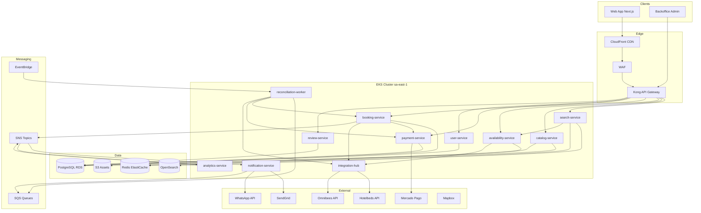

---

## 2. Diagrama de arquitetura — camadas

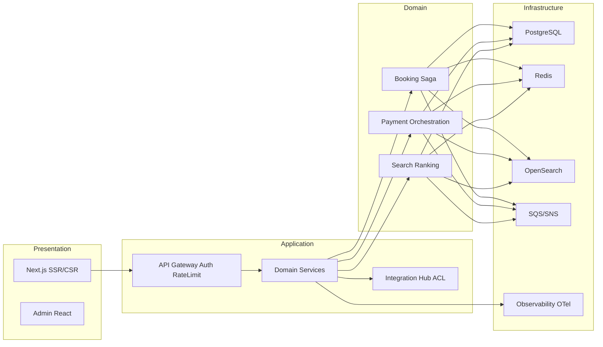

---

## 3. Diagrama de sequência — Reserva (happy path)

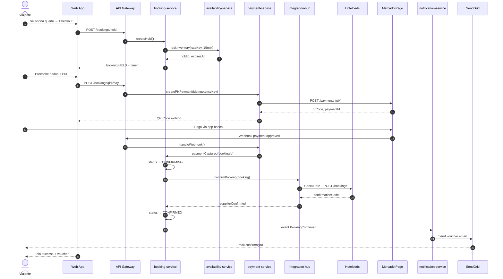

---

## 4. Diagrama de sequência — Falha fornecedor (compensação)

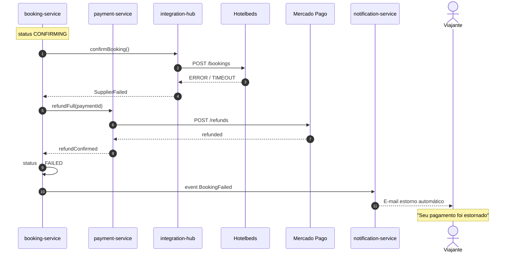

---

## 5. Diagrama de sequência — Cancelamento

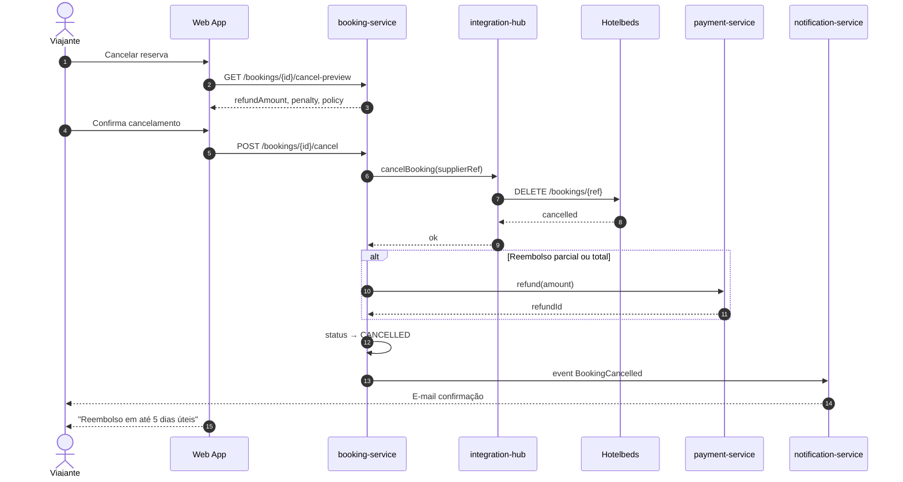

---

## 6. Diagrama de entidades (ERD)

```mermaid
erDiagram
    HOTELS ||--o{ ROOM_TYPES : has
    ROOM_TYPES ||--o{ RATE_PLANS : offers
    RATE_PLANS ||--o{ DAILY_RATES : prices

    USERS ||--o{ BOOKINGS : makes
    HOTELS ||--o{ BOOKINGS : receives
    ROOM_TYPES ||--o{ BOOKINGS : reserved
    RATE_PLANS ||--o{ BOOKINGS : uses

    BOOKINGS ||--o{ BOOKING_GUESTS : includes
    BOOKINGS ||--o| PAYMENTS : has
    BOOKINGS ||--o{ BOOKING_STATUS_HISTORY : tracks
    BOOKINGS ||--o| REVIEWS : generates

    PAYMENTS ||--o{ REFUNDS : may_have
    PAYMENTS ||--o{ CHARGEBACKS : may_have

    USERS ||--o{ USER_CONSENTS : grants
    USERS ||--o{ SAVED_TRAVELERS : stores

    HOTELS {
        uuid id PK
        string supplier_code
        enum supplier_type
        string name
        string city
        string state
        decimal latitude
        decimal longitude
        enum status
    }

    ROOM_TYPES {
        uuid id PK
        uuid hotel_id FK
        string name
        int max_occupancy
        jsonb amenities
    }

    RATE_PLANS {
        uuid id PK
        uuid room_type_id FK
        enum cancellation_policy_type
        jsonb cancellation_rules
        enum meal_plan
    }

    BOOKINGS {
        uuid id PK
        string booking_code UK
        uuid user_id FK
        enum status
        date check_in
        date check_out
        int total_amount_cents
        jsonb cancellation_policy_snapshot
        string supplier_confirmation_code
    }

    PAYMENTS {
        uuid id PK
        uuid booking_id FK
        int amount_cents
        enum method
        enum status
        string gateway_payment_id
    }

    REVIEWS {
        uuid id PK
        uuid booking_id FK UK
        int rating
        text comment
        enum status
    }
```

---

## 7. State machine — Booking

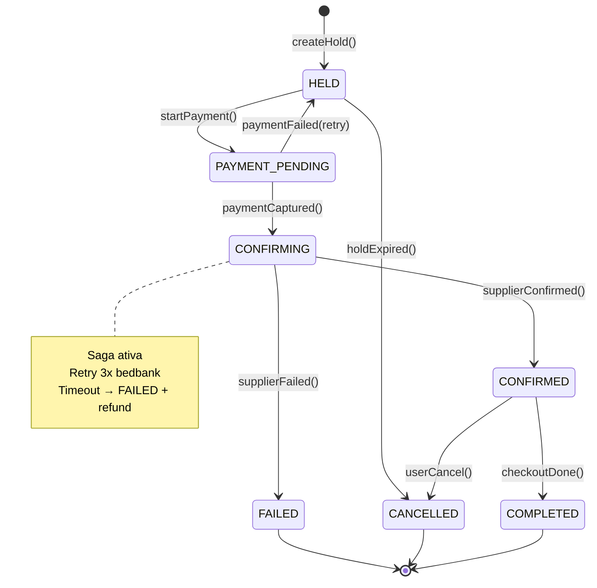

---

## 8. Fluxos de usuário

### 8.1 Busca de hotéis

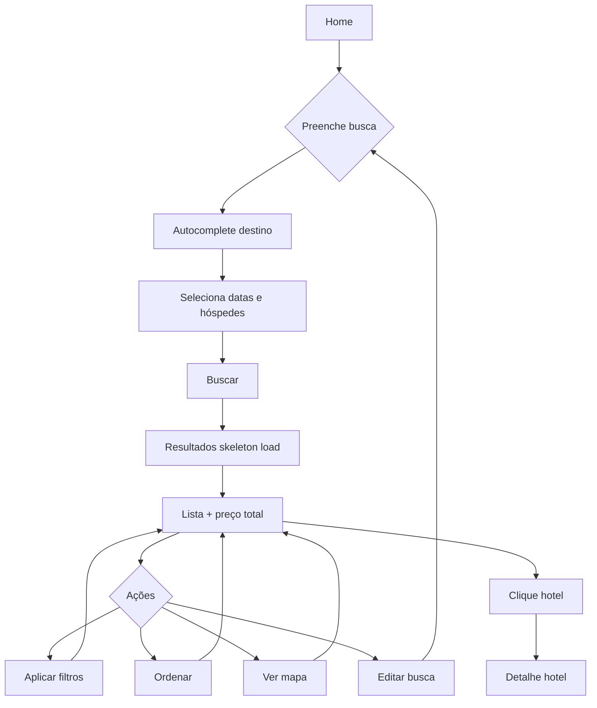

### 8.2 Reserva e pagamento

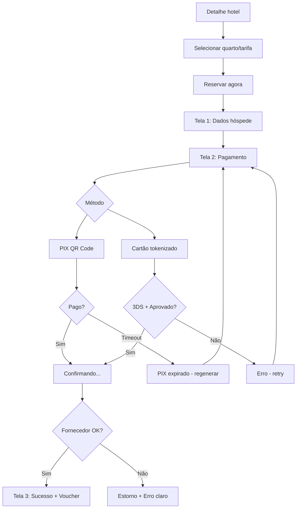

### 8.3 Cancelamento

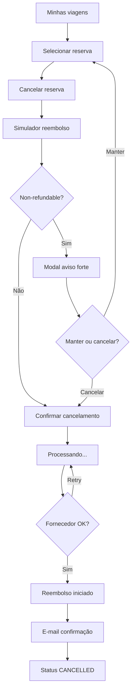

---

## 9. Diagrama de deployment (AWS)

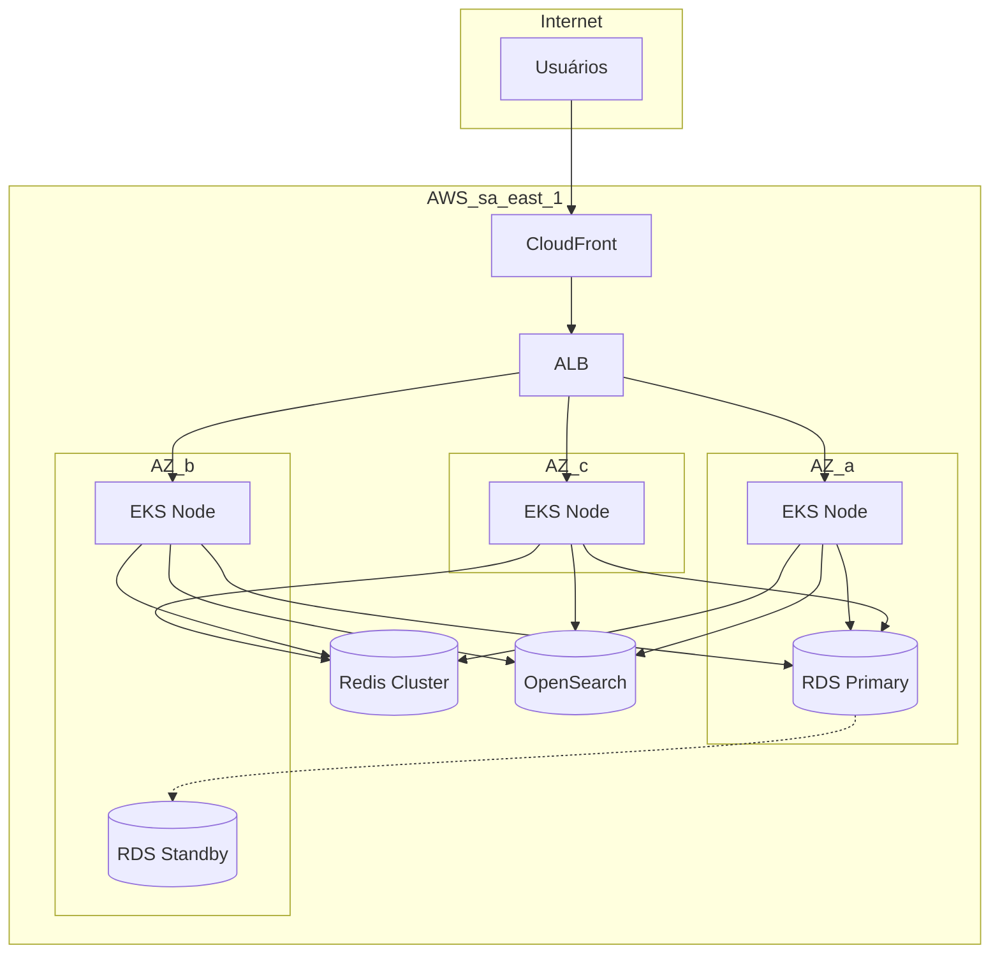

---

## 10. Diagrama de integrações

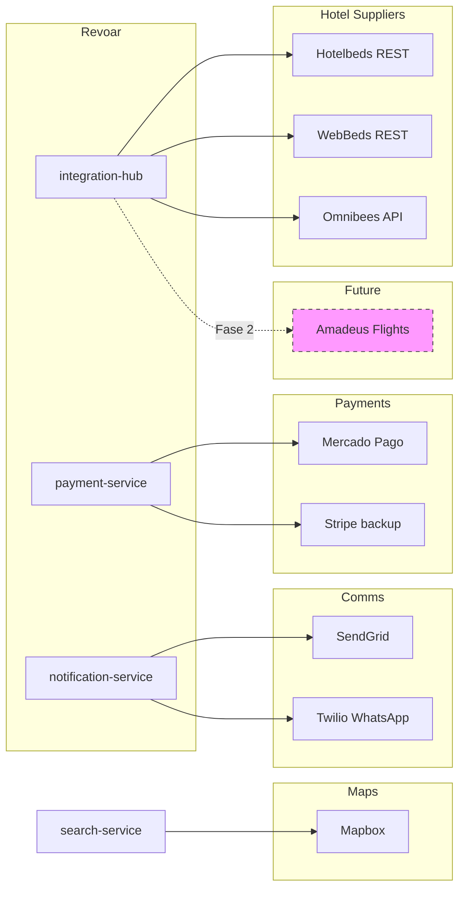

---

## 11. Diagrama C4 — Contexto simplificado

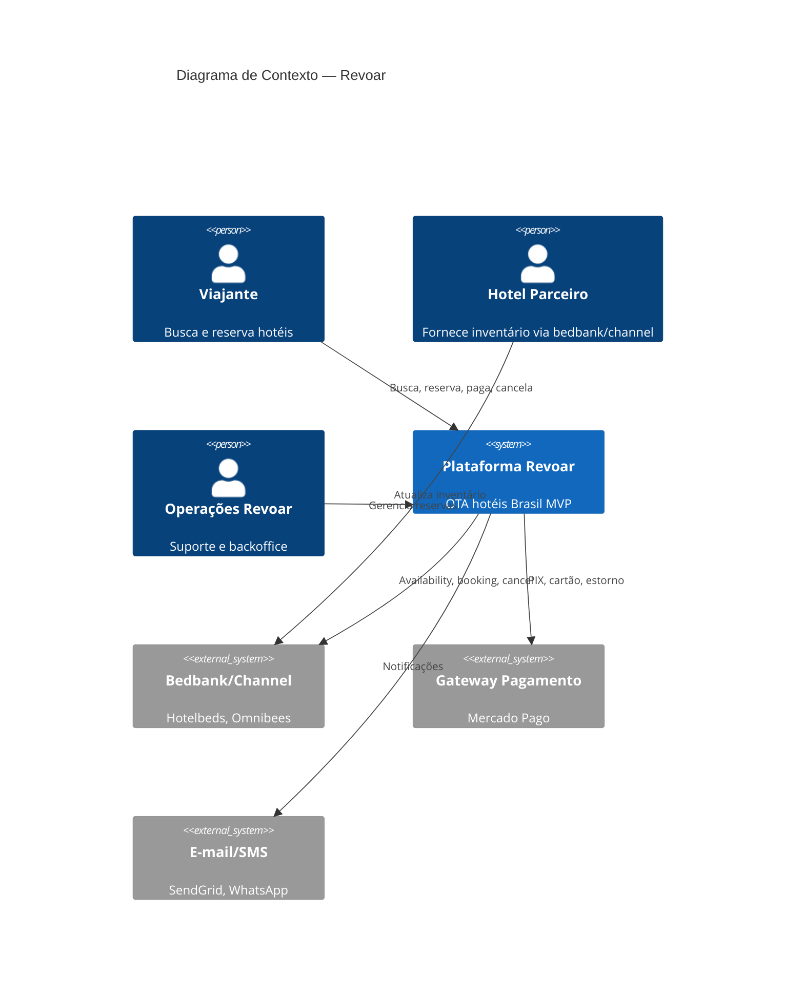

---

## 12. Fluxo de dados — Busca (read path)

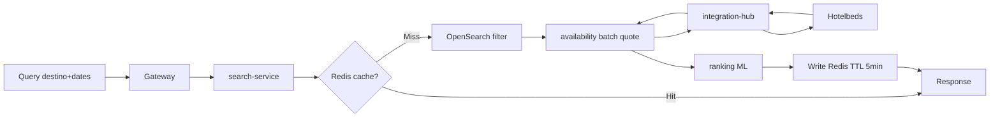

---

## 13. Mapa de consistência entre documentos

| Diagrama | Fase origem | Consistência verificada |
|----------|-------------|-------------------------|
| Arquitetura containers | Fase 5 | Serviços §3.1 ✓ |
| Sequência reserva | Fase 5 §4.2, Fase 7 §2.1 | Saga + Hotelbeds ✓ |
| ERD | Fase 6 §2 | Entidades + FKs ✓ |
| State machine | Fase 6 §3 | Transições §3.2 ✓ |
| Fluxos UX | Fase 4 §4–7 | 3 telas checkout ✓ |
| Integrações | Fase 7 | Adapters ✓ |
| Deployment | Fase 5 §6 | Multi-AZ ✓ |
| Roadmap Gantt | Fase 9 | Releases ✓ |
| Monorepo + sync 0.0 | Addendum Jul/2026 | Código atual ✓ |

---

## 14. Conclusão do Master Plan

Com a conclusão desta fase, o **Master Plan Revoar** está completo:

| Fase | Documento | Status |
|------|-----------|--------|
| 0 | Análise de Mercado | ✅ |
| 1 | Product Discovery | ✅ |
| 2 | Modelo de Negócio | ✅ |
| 3 | Requisitos | ✅ |
| 4 | UX | ✅ |
| 5 | System Design | ✅ |
| 6 | Modelagem de Dados | ✅ |
| 7 | Integrações | ✅ |
| 8 | Análise de Riscos | ✅ |
| 9 | Roadmap | ✅ |
| 10 | Diagramas | ✅ |

O sistema Revoar está **completamente definido em nível de engenharia** para iniciar a Release 0.1 (Foundation), com:

- Proposta de valor e personas validadas contra mercado
- Unit economics e modelo de receita
- 47 requisitos funcionais + RNFs + regras de negócio
- UX mobile-first com checkout 3 telas
- Arquitetura microservices AWS com saga de reserva
- Modelo de dados PostgreSQL com lifecycle de booking
- Integrações Hotelbeds + Mercado Pago
- Registro de riscos com mitigações
- Roadmap 24 meses com MVP GA em 9 meses
- Diagramas de arquitetura, sequência, ERD e fluxos

**Próximo passo recomendado:** Iniciar Release 0.1 — setup infra Terraform + integration-hub Hotelbeds sandbox.

---

*Documento final do Master Plan Revoar.*

---

## Addendum de implementação — Release 0.0 (Jul/2026)

Diagrama do que **está no código hoje** (não substitui os C4-alvo acima).

### A. Monorepo atual

```mermaid
flowchart LR
    EXT[apps/extranet :3000]
    ADM[apps/admin :3001]
    API[apps/api :3002]
    DB[(PostgreSQL 16)]
    S3[LocalStack S3 :4566]
    SH[@revoar/shared]
    PR[@revoar/database]

    EXT -->|REST + SSE JWT| API
    ADM -->|REST + SSE JWT| API
    API --> PR --> DB
    API --> S3
    EXT --> SH
    ADM --> SH
    API --> SH
```

### B. Sync sem F5 (Fase 7)

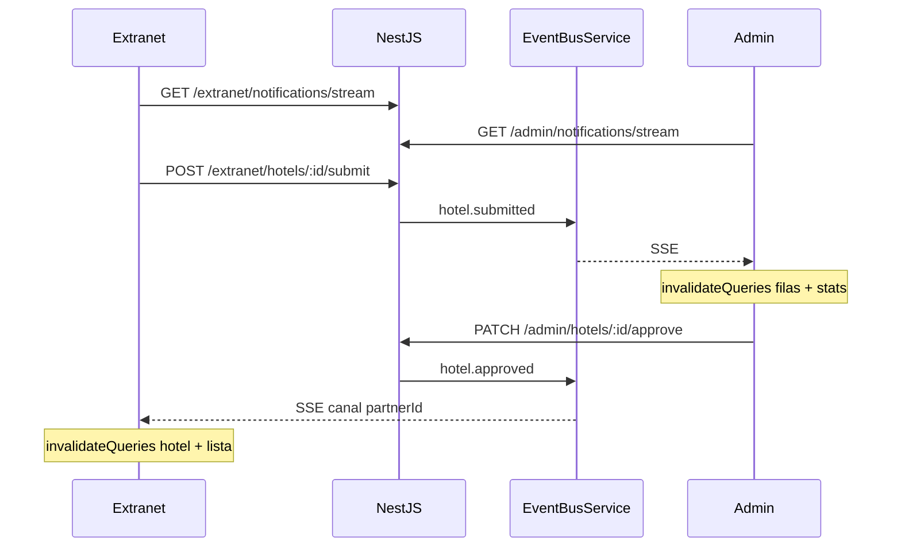

Spec: `.specs/features/sync-tempo-real/design.md`.
