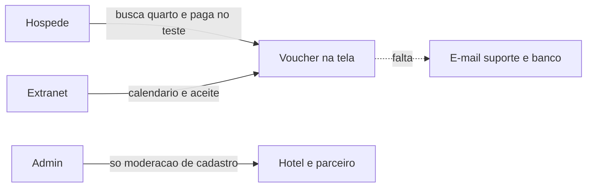

# Fase 12 — Jornada completa da reserva

**Projeto:** Revoar
**Versão:** 1.0
**Data:** Outubro/2026
**Dependências:** Fase 11 (área do cliente), Release 0.0 (extranet e admin)
**Status:** Plano. A reserva já chega ao voucher na tela, em ambiente de teste. Nenhuma fatia desta fase está em código.

Este documento continua a [Fase 11](../11-area-do-cliente/fase-11-area-do-cliente.md). As decisões AD-015 a AD-021 continuam valendo. Onde a Fase 11 descreve o desenho da reserva e este documento descreve o que ainda falta para operá-la, vale este documento.

---

## 1. Onde a reserva para

O hóspede, no app `apps/guest`, busca cidade e datas, abre o hotel, vê a foto do quarto, escolhe uma tarifa e informa nome, e-mail, telefone e CPF. Na reserva imediata o quarto fica segurado por 15 minutos. O botão **Confirmar pagamento de teste** grava a reserva, o código `REV-` e o voucher, com WhatsApp e arquivo `.ics`. Sob consulta o pedido segue sem cobrança. O parceiro aceita ou recusa em `apps/extranet`. Se aceitar, o mesmo pagamento de teste confirma em até 2 horas. Cancelar devolve a vaga e aplica a política na API.

Isso vale para hotel e pousada de parceiro com CNPJ, inventário `DIRECT`. O dinheiro não passa por um banco. O código PIX é uma string. Não há QR, webhook nem cartão tokenizado.

---

## 2. Decisões

| ID | Decisão |
|----|---------|
| AD-022 | A jornada operacional fecha antes do banco. PIX e cartão reais esperam a chave do Mercado Pago. Até lá o ambiente de teste permanece explícito na tela. |
| AD-023 | A conta do hóspede continua opcional. A viagem abre pelo código e pelo e-mail, e por um link enviado a esse e-mail. |
| AD-024 | O parceiro opera a reserva que o hóspede já cria: prazo das 24 horas visível, motivo na recusa, confirmadas em leitura, aviso sem atualizar a página. A grade do mês substitui o formulário de intervalo. |
| AD-025 | O admin busca a reserva, reenvia o voucher e cancela com motivo e auditoria. Não edita tarifa nem calendário do parceiro. |

---

## 3. O que cada lado já faz

### 3.1 Hóspede

Em `apps/guest`, porta 3003:

- Busca, card com foto e total, filtro “só reserva imediata”.
- Ficha com galeria do hotel e do quarto, tamanho, camas, ocupação e tarifas. A barra fixa leva ao checkout.
- Dados do hóspede, acompanhante opcional, idade das crianças e consentimento.
- Reserva imediata com relógio, PIX ou cartão, confirmação de teste, voucher, WhatsApp e calendário.
- Pedido sob consulta, pagamento só depois do aceite.
- Minhas viagens guarda os códigos deste navegador e abre pelo código e pelo e-mail.
- Cancelar chama a API. A política e o arrependimento de 7 dias já estão em `apps/api/src/booking/guest-booking.service.ts`.

Ainda não aparece na tela, embora a API já tenha o dado ou a rota:

- Comodidades do hotel e do quarto.
- Quantidade do mesmo tipo menor do que a busca pediu.
- Valor do reembolso antes de confirmar o cancelamento.
- Extensão única de 10 minutos (`POST /guest/bookings/:code/extend`).
- Novo código PIX de teste enquanto o prazo de pagar ainda vale.

### 3.2 Parceiro

Já está no código, e o estado antigo do repositório dizia o contrário:

- Perfil com avatar e logo, em `apps/extranet/src/app/profile/page.tsx`. O admin lê a mesma ficha em `apps/admin/src/app/partners/[id]/page.tsx` e não a edita.
- Reset de senha, em `apps/extranet/src/app/forgot-password/page.tsx` e `reset-password/page.tsx`.
- Fotos do hotel e do quarto, com a foto do quarto visível para o hóspede.
- Modo de reserva, tarifa, regras da casa, comodidades, abrir noite e bloquear noite, em `apps/extranet/src/app/hotels/[id]/availability/page.tsx`. O bloqueio de aluguel fora da plataforma já tira a vaga.
- Caixa de reservas em `apps/extranet/src/app/reservations/page.tsx`: lista, mensagem do hóspede, aceitar e recusar.

Ainda fino em relação à Fase 11, seções 4.3 e 4.4:

- O calendário é um formulário de intervalo, não uma grade do mês com noite sem configuração, aberta ou bloqueada, e com a vaga já confirmada no Revoar.
- A recusa não pede motivo. O prazo das 24 horas não aparece.
- Confirmadas, holds e pedidos ficam na mesma lista, sem separação de leitura.
- Um pedido novo só aparece quando a página busca de novo. A extranet já tem canal de eventos para a moderação. A reserva ainda não entra nele.

Trocar modo, tarifa ou calendário continua sem devolver o hotel para análise. Texto, fotos e endereço de hotel ativo continuam sujeitos à correção com nova aprovação.

### 3.3 Admin

`apps/admin` aprova e suspende parceiro, aprova e rejeita hotel, e mostra a ficha do parceiro. Não há rota de reserva. A Fase 11, seção 5, ainda não foi construída: buscar por código, e-mail ou hotel, reenviar voucher, cancelar com auditoria.

### 3.4 E-mail

`apps/api/src/notifications/notifications.service.ts` envia cadastro, aprovação, rejeição e reset do parceiro. Sem `RESEND_API_KEY`, o serviço registra a mensagem e não chama o provedor. Nenhum e-mail de reserva, aceite, recusa ou voucher existe.

---

## 4. Ordem de construção

Cada fatia entra quando a anterior fecha. Hotelbeds não entra em nenhuma delas.

### Fatia 1 — Ficha honesta

Mostrar as comodidades que a API já devolve. Na ficha, a quantidade do mesmo tipo pode baixar até 1, nunca acima da busca nem da vaga livre. Na reserva, o cancelamento mostra o reembolso antes do sim. O botão de mais 10 minutos aparece uma vez, enquanto o quarto imediato está segurado. Enquanto o prazo de pagar vale, dá para gerar outro código PIX de teste.

Pronto quando: a ficha da Pousada Atlântico mostra piscina e varanda. Cancelar uma reserva flexível com check-in a mais de 7 dias mostra reembolso integral antes de confirmar. O segundo clique em estender o hold é recusado.

### Fatia 2 — E-mail da reserva

Mensagens: pedido enviado, aceite, recusa, voucher confirmado e link para abrir a viagem. Reusa o serviço de notificação. Sem chave, o teste lê a mensagem registrada. Com chave, o mesmo texto sai pelo provedor.

Pronto quando: uma reserva imediata confirmada no teste deixa um voucher endereçado ao e-mail do hóspede. Uma recusa deixa a mensagem de que nada foi cobrado.

### Fatia 3 — Minhas viagens

Três listas: próximas, anteriores e canceladas. A origem é o código com o e-mail, e o link da fatia 2. O navegador pode continuar lembrando os códigos, mas a lista não depende só dele.

Pronto quando: abrir o link do e-mail mostra a reserva confirmada em próximas, e a cancelada em canceladas, num navegador que nunca fez a reserva.

### Fatia 4 — Extranet no mesmo ponto

Grade do mês por tipo de quarto. Cada noite mostra sem configuração, aberta ou bloqueada, e quantas unidades já estão confirmadas no Revoar. Recusa exige motivo opcional e mostra o prazo que falta das 24 horas. Confirmadas ficam em leitura: código, hóspede, quarto, datas, total e status. Pedido novo chega pelo canal de eventos que a extranet já usa.

Pronto quando: o parceiro vê, sem atualizar a página, um pedido sob consulta. Recusar grava o motivo que o hóspede lê. A noite confirmada na plataforma aparece ocupada, e bloqueá-la não cancela essa reserva.

### Fatia 5 — Admin da reserva

Busca por código, e-mail ou hotel. Reenvio do voucher pelo mesmo e-mail da fatia 2. Cancelamento com motivo. O reembolso segue a política, ou é integral se o operador marcar exceção. Cada ação entra num histórico de status, no mesmo espírito do histórico do hotel. O admin não altera preço nem calendário.

Pronto quando: buscar `REV-` abre a reserva. Reenviar gera de novo a mensagem do voucher. Cancelar com exceção devolve o valor integral e a vaga, e o histórico mostra quem fez.

### Fatia 6 — Busca mais útil

A ordem padrão continua o menor total. A pessoa também pode ordenar por estrelas. A lista vazia oferece repetir a busca com as datas deslocadas em três dias, quando houver vaga. Mapa continua fora.

Pronto quando: a busca de Fortaleza sem vaga mostra o atalho, e ordenar por estrelas não muda o total exibido em cada card.

### Fatia 7 — Banco

Mercado Pago, QR e webhook de PIX, cartão tokenizado, estorno de verdade. Só começa quando as chaves existirem. O botão de teste sai da tela quando o webhook é quem confirma. Até lá, AD-022 mantém o sandbox visível.

Pronto quando: um PIX pago no provedor de teste confirma a reserva sem o botão manual, e o estorno de um cancelamento dentro da política aparece no provedor.

### Fatia 8 — Depois da estadia

Avaliação de 1 a 5 depois do check-out, uma vez por reserva, publicada após moderação. Mapa na listagem. Coleções. Lembrete de check-in. Operação piloto no Rio, São Paulo, Salvador, Fortaleza e Gramado. Bedbank só depois do fluxo `DIRECT` estável, como a Fase 11 já decidiu.

Pronto quando: uma reserva com check-out no passado aceita uma avaliação, e a ficha do hotel mostra a nota publicada.

---

## 5. Fora desta fase

- Casa, apartamento inteiro e anfitrião pessoa física.
- Conversa contínua com o hotel.
- Vários tipos de quarto no mesmo pedido.
- Alteração de datas pelo hóspede.
- Taxa de limpeza e preço por pessoa.
- Voos, pacotes, experiências e fidelidade.
- Aplicativo nativo.
- Vários usuários no mesmo parceiro. Continua fora até uma fase própria.

---

## 6. Critério da jornada completa

1. O hóspede vê o que está alugando: foto, tamanho, camas, ocupação, comodidades e total, e fecha em reserva imediata ou sob consulta.
2. O voucher chega na tela e no e-mail. A viagem abre de novo pelo link, em próximas, anteriores ou canceladas.
3. Cancelar mostra o reembolso antes, aplica a política da Fase 11 e devolve a vaga.
4. O parceiro abre e bloqueia noites numa grade, responde o pedido com prazo e motivo, e vê a reserva confirmada sem precisar bloqueá-la.
5. O admin encontra a reserva, reenvia o voucher e cancela com histórico.
6. O banco só entra na fatia 7. Antes disso, a tela deixa claro que a confirmação é de teste.

---

*Este documento faz parte do Master Plan Revoar. O desenho da reserva, dos estados e do preço continua na Fase 11.*
